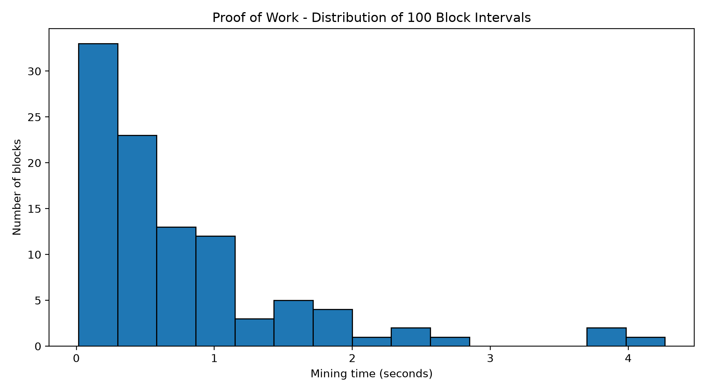
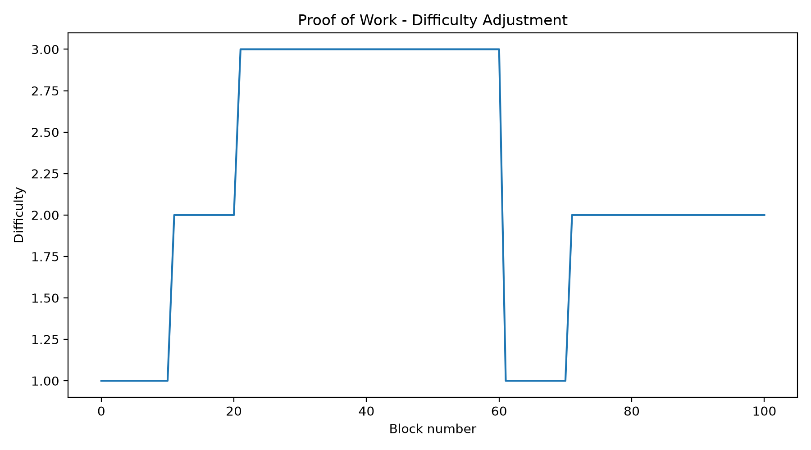
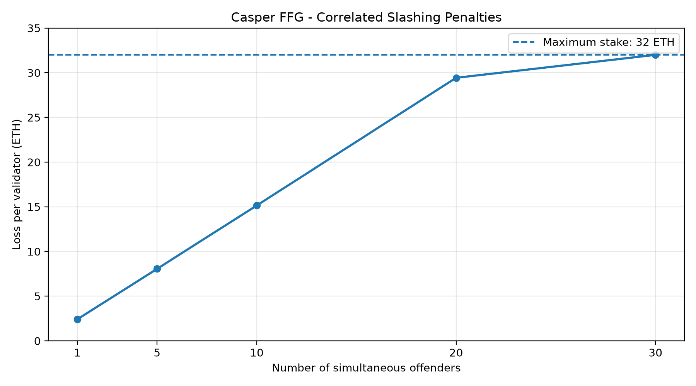
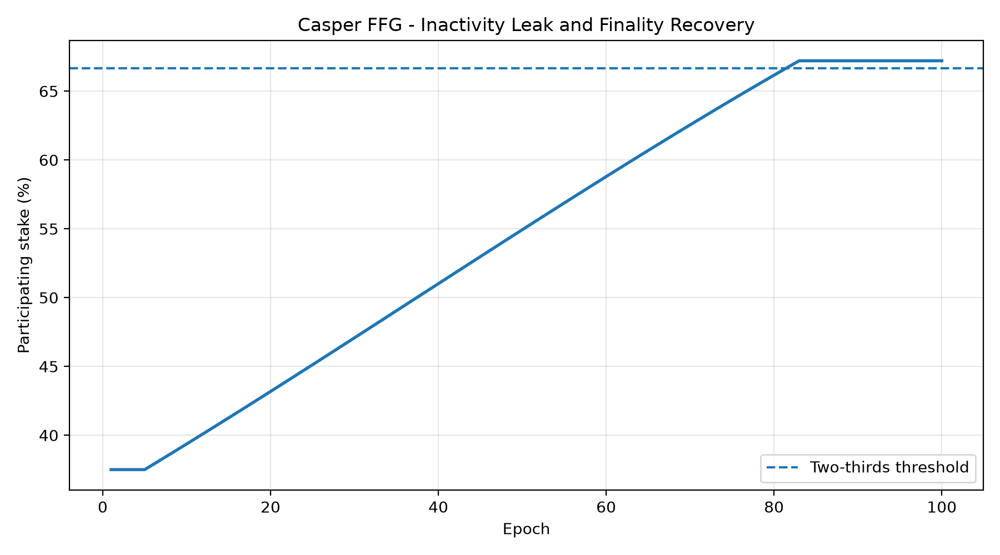

# Blockchain Lab 03 — Consensus Simulation

Python implementation of blockchain consensus mechanisms for Blockchain Lab 03 at Óbuda University.

This project demonstrates Proof of Work (PoW), Proof of Stake (PoS) using Casper FFG, and asynchronous gossip networking.

## 1. Features

### Part A — Proof of Work
- Block mining and Proof of Work verification
- Parallel mining with multiple workers
- Difficulty adjustment and retargeting
- Block interval statistics and distribution analysis
- Blockchain fork choice based on cumulative work

### Part B — Proof of Stake
- Validator management and effective balances
- Casper FFG checkpoint justification and finalisation
- Double-vote and surround-vote detection
- Individual and correlated slashing penalties
- Inactivity leak and finality recovery

### Part C — Gossip Networking
- Asynchronous transaction and block propagation
- Duplicate-message suppression
- Transaction validation
- Network partitions and reconnection
- Competing blockchain branches and chain reorganisations

## 2. Installation

Requirements:
- Python 3.12
- uv package manager

Create a virtual environment:

```powershell
uv venv --python 3.12
```

Install dependencies:

```powershell
uv pip install pytest pytest-asyncio matplotlib
```

## 3. Testing

Run the local test suite:

```powershell
uv run --no-project --python .venv\Scripts\python.exe python -m pytest test_consensus.py -q
```

**Result: 57 tests passed.**

The implementation was also verified against the professor's original reference test suite.

**Result: 42 tests passed.**

The reference tests are not included in this repository.

## 4. Experimental Results

### Part A — Proof of Work

A simulation of 100 mined blocks produced:

| Metric | Result |
|---|---:|
| Mean block interval | 0.7611 s |
| Median block interval | 0.5157 s |
| Standard deviation | 0.8348 s |
| Median / Mean | 0.678 |
| Standard deviation / Mean | 1.097 |





### Part B — Proof of Stake

The Casper FFG simulation demonstrated checkpoint justification and finalisation across consecutive epochs.

**Correlated slashing experiment**

| Simultaneous offenders | Loss per validator |
|---:|---:|
| 1 | 2.4084 ETH |
| 5 | 8.0558 ETH |
| 10 | 15.1462 ETH |
| 20 | 29.4320 ETH |
| 30 | 32.0000 ETH |



**Inactivity leak experiment**

With 24 of 64 validators participating, the initial voting share was 37.5%. Inactivity penalties gradually reduced the stake of non-participating validators.

Justification resumed at epoch 82, and finalisation resumed at epoch 83.



### Part C — Gossip Networking

A six-node network was partitioned into two groups.

- Group A mined three blocks.
- Group B mined five blocks.
- After reconnection, the higher-work branch was adopted by all six nodes.
- Nodes in Group A experienced a reorganisation of depth three.
- All nodes converged on a common canonical chain.

The experiment results are available in `partC_partition_results.csv`.

## 5. Reproduce the Experiments

Run the following scripts from the project root:

```powershell
python partA_parallel_demo.py
python partA_statistics.py
python partA_charts.py

python partB_finality_demo.py
python partB_slashing_demo.py
python partB_slashing_chart.py
python partB_inactivity_demo.py
python partB_inactivity_chart.py

python partC_partition_demo.py
```

Note that rerunning stochastic experiments can produce different measurements and overwrite previously saved results.

## 6. Implementation Limitations

This project is an educational consensus simulation, not production blockchain software.

The asynchronous network uses simplified in-memory communication and chain synchronisation. In the reference-test simulation, certain locally constructed blocks are accepted during synchronisation without repeating Proof of Work validation.

The inactivity-leak and slashing mechanisms are simplified models intended to demonstrate consensus principles. They do not reproduce every parameter or state transition of the Ethereum mainnet protocol.

## 7. Repository

[Blockchain Lab 03 — Consensus Simulation](https://github.com/korneliasara/blockchain-lab03-consensus-simulation)

Developed for educational purposes as part of Blockchain Lab 03 at Óbuda University.