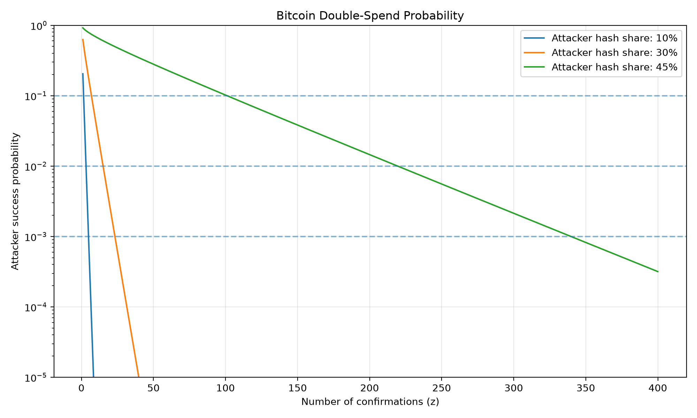

# Bonus E1 — Double-Spend Probability

**Blockchain Lab 03 | +1 Bonus Point**

## Objective

Implement the attacker-success probability formula from Section 11 of the Bitcoin whitepaper and verify the results using Monte Carlo simulation.

## Implementation

The analytical calculation uses the whitepaper's Poisson approximation to estimate an attacker's probability of catching up after a transaction receives a given number of confirmations.

The Monte Carlo simulation samples the number of attacker blocks using the same Poisson model and simulates whether the attacker eventually catches up.

## Results

### Published reference values

| Attacker hash share | Confirmations | Success probability |
|---|---:|---:|
| 10% | 5 | 0.0009137 |
| 10% | 6 | 0.0002428 |
| 30% | 5 | 0.1773523 |

All three published reference values were reproduced.

### Monte Carlo verification

| Attacker share | Confirmations | Trials | Relative error |
|---|---:|---:|---:|
| 10% | 5 | 1,000,000 | 3.47% |
| 10% | 6 | 5,000,000 | 5.77% |
| 30% | 5 | 1,000,000 | 0.04% |

All three simulation estimates were within 10% of the analytical probability in the recorded run.

### Confirmation thresholds

Minimum confirmations needed to reduce attacker success probability below the specified threshold:

| Attacker share | Below 10% | Below 1% | Below 0.1% |
|---|---:|---:|---:|
| 10% | 2 | 4 | 5 |
| 30% | 7 | 16 | 24 |
| 45% | 102 | 220 | 340 |

## Probability Graph



## Running the Experiment

From this directory, run:

```powershell
python bonus_E1_double_spend.py
python bonus_E1_chart.py
```

The experiment generates a CSV containing the confirmation thresholds and a probability-versus-confirmations graph.

## Conclusion

The results demonstrate that increasing confirmation depth reduces the probability of a successful double-spend attack. However, the number of confirmations required increases dramatically as the attacker's share of total hash power approaches 50%.

The Monte Carlo simulation is based on the same Poisson approximation as the analytical formula, rather than an independent continuous-time mining race.