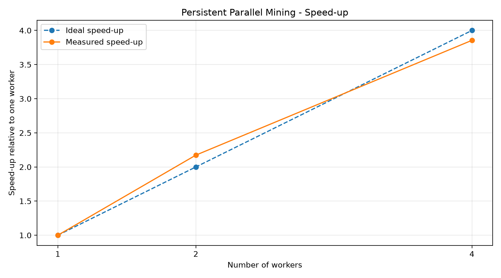
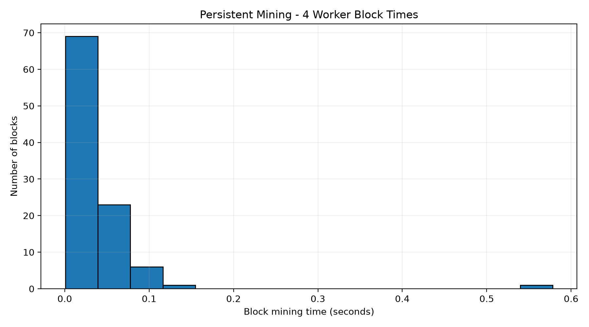

# Bonus E2 — Scalable Parallel Proof of Work Mining

**Blockchain Lab 03 | +2 Bonus Points**

## Objective

Implement a persistent multiprocessing miner that reuses worker processes across successive blocks instead of creating new processes for every mining attempt.

Evaluate scalability using 1, 2 and 4 workers, investigate block-time distributions and compare measured speed-up with ideal linear scaling.

## Implementation

The miner uses Python's `multiprocessing` module with the Windows-compatible `spawn` method.

Each worker:

- Starts once and remains available for multiple mining jobs.
- Receives block-header and difficulty-target information through a multiprocessing queue.
- Searches a disjoint sequence of nonces.
- Coordinates termination through a shared event.
- Reports its result to the main process.

The implementation uses a standalone SHA-256 proof-of-work benchmark. It is an educational performance experiment rather than a replacement for the main Lab 03 consensus implementation.

## Experimental Method

A benchmark was conducted using 100 blocks for each configuration: 1, 2 and 4 workers, with the same mining target.

Hardware:

- AMD Ryzen 7 6800H
- 8 physical cores, 16 logical processors
- Python 3.12, 64-bit
- Windows

The nominal probability of a successful hash attempt was approximately 1 in 100,000.

## Final Benchmark Results

| Metric | 1 worker | 2 workers | 4 workers |
|---|---:|---:|---:|
| Mean mining time (s) | 0.13963 | 0.06425 | 0.03622 |
| Median / mean | 0.634 | 0.600 | 0.555 |
| Standard deviation / mean | 0.952 | 1.159 | 1.700 |
| Measured speed-up | 1.00× | 2.17× | 3.86× |
| Ideal speed-up | 1.00× | 2.00× | 4.00× |

The mean mining times were approximately proportional to 1 : 0.46 : 0.26, close to the ideal 1 : 0.5 : 0.25 scaling relationship.

The four-worker configuration achieved a 3.86× measured speed-up relative to the single-worker baseline.

## Speed-up Plot



## Mining-Time Distribution

For an ideal exponentially distributed block interval:

- Median / mean ≈ 0.693
- Standard deviation / mean ≈ 1.000

The four-worker experiment produced a median/mean ratio of 0.555 and a standard-deviation/mean ratio of 1.700.

These results show a right-skewed distribution, but the measured variability is greater than the ideal exponential prediction.

Potential explanations include stochastic sampling variation, operating-system scheduling, background system activity and inter-process synchronisation overhead.



## Worker Persistence

A separate diagnostic verified that worker process identifiers remained unchanged across multiple mining jobs.

All worker processes remained alive during the test.

The automated test suite also verifies nonce validity and worker reuse.

**Automated testing: 5 tests passed.**

## Performance Limitations

Earlier benchmark runs showed weaker scaling, including cases where four workers performed worse than one.

The final benchmark showed substantially better parallel performance. Both results are relevant: hardware scheduling, coordination costs and random mining times influence observed speed-up.

The results should not be interpreted as guaranteed performance on every machine or every run.

## Reproducing the Experiment

From the Lab 03 project root:

```powershell
uv run --no-project --python .venv\Scripts\python.exe python .\bonus_challenges\E2_scalable_mining\bonus_E2_miner.py
```

Run the benchmark:

```powershell
uv run --no-project --python .venv\Scripts\python.exe python .\bonus_challenges\E2_scalable_mining\bonus_E2_benchmark.py
```

Run automated tests:

```powershell
uv run --no-project --python .venv\Scripts\python.exe python -m pytest .\bonus_challenges\E2_scalable_mining\test_bonus_E2.py -v
```

The benchmark writes CSV measurements and generated charts to the E2 directory.

## Conclusion

The experiment demonstrates reusable multiprocessing workers, disjoint nonce searching, valid Proof of Work solutions and substantial measured parallel speed-up.

The final 100-block benchmark achieved approximately 3.86× speed-up with four workers, while also revealing deviations from ideal exponential timing behavior.

The results illustrate both the potential benefits and practical performance limitations of parallel blockchain mining simulations.