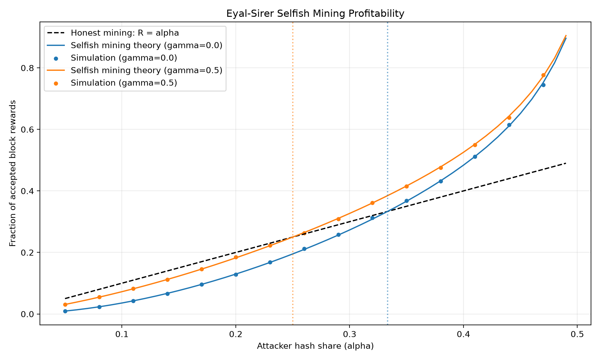

# Bonus E3 — Eyal–Sirer Selfish Mining

**Blockchain Lab 03 | +2 Bonus Points**

## Objective

Implement and analyse the Eyal–Sirer selfish-mining strategy using a standalone event-driven simulation.

The experiment studies how an attacker-controlled mining pool can increase its relative block-reward share by strategically withholding and publishing blocks.

## Methodology

The simulation models honest and selfish miners competing to extend the blockchain.

The two main parameters are:

- **α (alpha):** The selfish pool's fraction of total mining power.
- **γ (gamma):** The fraction of honest mining power that chooses the selfish pool's branch during a public tie.

The simulation implements private-chain withholding, publication when honest miners catch up, public tie resolution, and private-chain lead management.

A theoretical revenue calculation is included to validate the simulation.

## Results

| Alpha | Gamma | Honest revenue | Theoretical selfish revenue | Simulated selfish revenue |
|---|---|---|---|---|
| 0.20 | 0.0 | 20% | 12.97% | 12.96% |
| 0.30 | 0.0 | 30% | 27.31% | 27.25% |
| 0.40 | 0.0 | 40% | 48.37% | 48.31% |
| 0.20 | 0.5 | 20% | 18.24% | 18.19% |
| 0.30 | 0.5 | 30% | 32.69% | 32.61% |
| 0.40 | 0.5 | 40% | 52.56% | 52.49% |

The simulated results closely match the theoretical values.

## Profitability Thresholds

The theoretical profitability threshold is:

\[
\alpha > \frac{1-\gamma}{3-2\gamma}
\]

For γ = 0, selfish mining becomes profitable above an attacker hash share of **33.33%**.

For γ = 0.5, selfish mining becomes profitable above **25%**.

## Revenue Comparison



The dashed black line represents honest mining, where relative revenue equals alpha. The coloured curves represent the analytical selfish-mining model, and the plotted points represent simulation estimates.

## Why 51% Is Not Necessary

Controlling more than half the mining power is sufficient for certain majority attacks, but it is not necessary for all economically harmful mining strategies.

Selfish mining exploits block propagation and strategic withholding to achieve disproportionate rewards below the majority threshold.

A selfish mining pool with a favourable tie-breaking advantage can earn a higher fraction of accepted blocks than its hash-power share.

This does not imply that minority hash power can automatically execute arbitrary chain reorganisations or double-spend attacks.

## Running the Experiment

From the Lab 03 project directory:

```powershell
uv run --no-project --python .venv\Scripts\python.exe python .\bonus_challenges\E3_selfish_mining\bonus_E3_selfish_mining.py
```

Run the automated tests:

```powershell
uv run --no-project --python .venv\Scripts\python.exe python -m pytest .\bonus_challenges\E3_selfish_mining\test_bonus_E3.py -v
```

The experiment generates the revenue comparison CSV and graph.

## Reference

Eyal, I., & Sirer, E. G. (2014). *Majority Is Not Enough: Bitcoin Mining Is Vulnerable.* Financial Cryptography and Data Security.

https://arxiv.org/abs/1311.0243